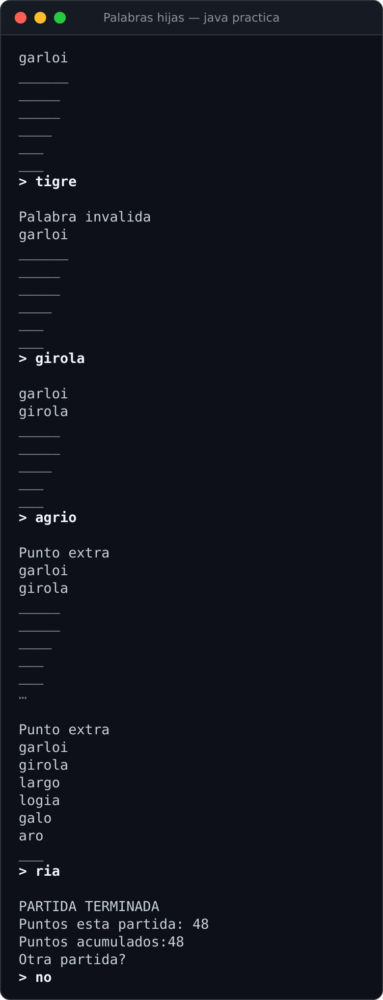

<div align="center">

# Palabras hijas

**Juego de anagramas para consola en Java: adivina la palabra oculta y todas las palabras que caben en sus letras**


<sub>Fundamentos de Programación · Grado en Ingeniería Informática · Universidad de Valladolid · Curso 2021-2022</sub>

</div>

Una partida completa, recortada en el centro (`…`). Las líneas que empiezan por `>` son lo que escribe el jugador; el programa no las repite.

<p align="center">
  
  <br>
  <sub>Salida real del programa.</sub>
</p>

La primera línea es la palabra base desordenada. Debajo están sus huecos y los de las 5 palabras hijas previstas, que se rellenan al acertarlas; las hijas no previstas dan un punto extra.

## En pocas palabras

- **Reto**: generar en cada partida un anagrama al azar a partir de un diccionario y comprobar las respuestas del jugador letra a letra.
- **Solución**: un programa de consola que elige una palabra base, calcula todas sus palabras hijas en el diccionario, puntúa los aciertos y guarda la puntuación acumulada entre partidas.
- **Demuestra**: diseño de algoritmos sobre cadenas, descomposición en funciones, lectura y escritura de ficheros y validación de la entrada.

## Lo más destacado

- **Comprobación de anagramas por eliminación de letras**: `esPalabraHija` quita de la base cada letra que usa la candidata, así que ninguna letra se puede usar más veces de las que aparece.
- **Barajado sin repeticiones**: `desordenar` marca con un array de `boolean` las posiciones ya usadas para no repetir ninguna letra al desordenar.
- **Partidas aleatorias**: la palabra base y las 5 hijas previstas se eligen al azar, y el resto de hijas del diccionario dan un punto extra.
- **Validación de la entrada**: distingue palabras con letras que no están en la base (`Palabra invalida`), palabras que no están en el diccionario y palabras ya acertadas.
- **Persistencia**: lee el diccionario con `Scanner` sobre `File` y guarda la puntuación acumulada en `puntuacion.txt` con `PrintWriter`.

## Competencias

| Área | Qué se aplicó |
|------|---------------|
| Algoritmia | Recorrido y eliminación de caracteres para validar anagramas; selección aleatoria sin repetición |
| Diseño | Lógica repartida en funciones pequeñas (`desordenar`, `esPalabraHija`, `esValido`, `palabrasHijasPrevistas`...) que coordina `main` |
| Ficheros | Lectura del diccionario y escritura de la puntuación con la biblioteca estándar |

## Cómo se juega

- La palabra base tiene 6 letras o más y se muestra desordenada.
- La base y las hijas previstas suman tantos puntos como letras tienen; cualquier otra hija del diccionario suma un punto.
- La partida termina al acertar la base y las 5 hijas previstas. Después el programa muestra los puntos de la partida y los acumulados, y pregunta si se quiere jugar otra (`si` para seguir).
- El diccionario está ordenado de mayor a menor longitud, y el programa se apoya en ese orden para localizar las palabras base.

## Estructura del repositorio

```text
FProg/
├── practica.java     # Programa completo (clase practica)
└── diccionario.txt   # Diccionario de palabras, una por línea
```

## Cómo ejecutarlo

Requiere un JDK con `javac` y `java`. Ejecútalo desde la carpeta del repositorio, para que el programa encuentre `diccionario.txt`:

```bash
javac practica.java
java practica
```

El programa crea `puntuacion.txt` en el directorio de trabajo.

## Autoría

Trabajo en pareja (grupo Z9), según la cabecera de `practica.java`:

- Javier García González
- Javier Esgueva Sto. Domingo

---

<div align="center"><sub>Parte de <a href="https://github.com/JavivuG/UVa-Projects">UVa-Projects</a> · Javier García González</sub></div>
